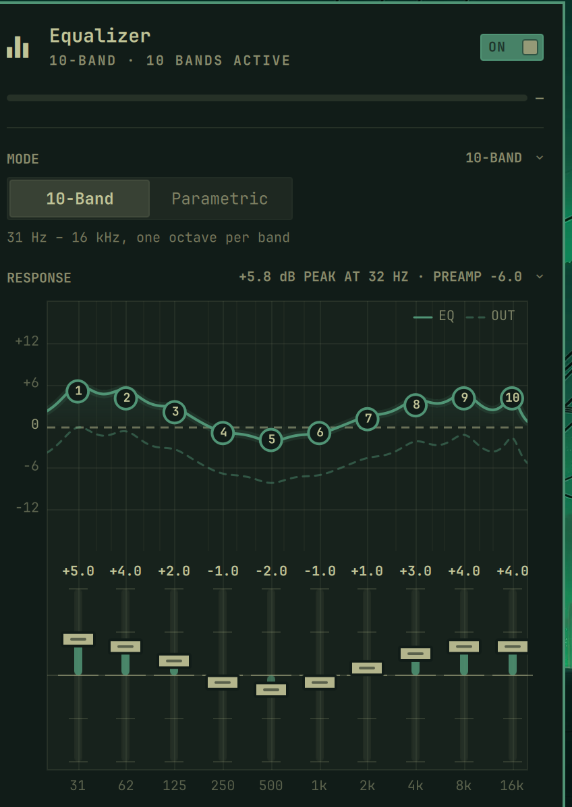
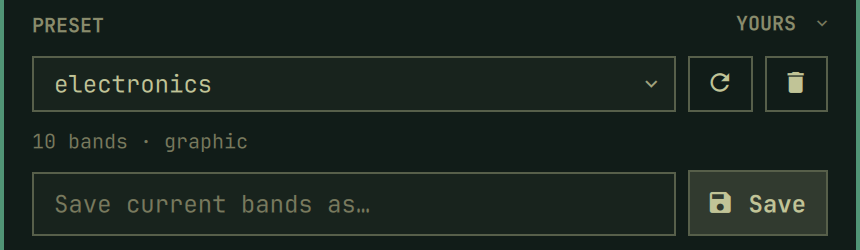

# Equalizer

An Omarchy shell plugin that puts a system-wide equalizer in front of any PipeWire
output: a 10-band graphic EQ whose faders set what the curve does at their
frequencies, up to 16 parametric bands edited on the curve (with bypass, solo
and 12–48 dB/oct pass filters), level-matched presets with a level-matched A/B,
undo and redo, AutoEq headphone import, headroom that is Safe, Balanced or
manual and gives its cut back below full volume, a curve per output device, and
a stereo output stage (a linked brickwall limiter, a multiband boost with night
and voice characters, and a loudness leveler), plus mono/swap/balance and
per-app exclusions.

Every adjustment is heard while the hand moves: a drag is streamed into the
running graph as it happens (about 15 ms from a move to the graph), and filed --
one state write, one undo step -- when it is let go.

<p align="center">
  
</p>

The panel keeps the power switch, the output level and the preset picker fixed
at the top; below them a tab bar switches between **Response** (the curve with
the shape of what is playing behind it, the 10-band faders or the parametric
handles and the selected band's strip, the mode switch, the preamp and the
headroom), **Bands** (one card per band, parametric mode only), **Output**
(limiter, device relief, dynamics, leveler, channels, device curves and apps)
and **AutoEq**.

Everything is driven from the panel; the same operations are available from the
command line.

## Install

```sh
omarchy plugin add https://github.com/creolben/omarchy-equalizer.git --enable
```

That is the whole install. The plugin carries its own backend
(`bin/omarchy-equalizer`) and the panel addresses it inside the plugin directory,
so nothing has to be put on `PATH`. It appears in the bar as an equalizer icon;
click it, or run `omarchy-shell shell summon io.github.creolben.equalizer`.

To work on the plugin instead, clone it in place:

```sh
git clone https://github.com/creolben/omarchy-equalizer.git \
  ~/.config/omarchy/plugins/io.github.creolben.equalizer
omarchy plugin enable io.github.creolben.equalizer
./install.sh    # optional: puts the `omarchy-equalizer` CLI on your PATH
```

### Requirements

- Omarchy (quickshell) with a systemd user session
- PipeWire and `pactl`/`parec` (pipewire-pulse, libpulse), `jq`, `awk`,
  coreutils and `flock` (util-linux)
- `python3` for the spectrum drawn behind the curve
  (`bin/omarchy-equalizer-spectrum`). It reads the equalizer's own output stream
  -- what you hear, after every band and the output stage -- through
  `parec --monitor-stream`, turns it into 24 band levels in memory and prints
  them to the panel; it writes no files, uses no network, and runs only while
  the panel is open and the equalizer is on.
- `curl` for AutoEq import; `node` to run the test suite
- Optional: `lsp-plugins-lv2` for the output stage (its stereo
  `para_equalizer_x16`, `mb_compressor`, `limiter` and `autogain` builds). Without
  it the equalizer runs as a pure EQ on PipeWire's builtin biquads and the
  limiter, dynamics and leveler controls report the stage as inactive; channels,
  device curves and app exclusions still work.
- Optional but recommended: with `lsp-plugins-lv2`, both modes run on a resident
  16-slot LSP equalizer, so every edit -- a preset of either mode, a mode switch,
  a band's type, slope or bypass, adding/removing bands, an AutoEq import -- is a
  live `pw-cli` write rather than a filter-chain restart. Without it, a shape
  change still restarts the chain (players may pause for it), and every band
  change clicks once: PipeWire's builtin biquad clears its history on each
  update (measured in `tests/dsp-check.sh`), so the live editor writes it at
  most ten times a second.

Enabling makes the equalizer the default sink and moves application streams onto
it (an excluded app goes straight to the device instead); disabling restores the
output you had selected. The equalizer's own volume (its sink in pavucontrol,
or `wpctl`/`pactl` on it) is applied inside the graph after the bands and the
dynamics and before the limiter (see [Gain staging](#gain-staging)). Omarchy's
volume keys resolve through the equalizer to the device it plays into and move
that device's volume instead, so with them the equalizer's own volume stays at
100%.

### Uninstall

Take the equalizer out of the audio path **first** — that restores the output
device you had selected and stops both units, so removing the plugin afterwards
cannot leave your machine pointing at a sink that no longer exists:

```sh
~/.config/omarchy/plugins/io.github.creolben.equalizer/bin/omarchy-equalizer disable
omarchy plugin disable io.github.creolben.equalizer
omarchy plugin remove io.github.creolben.equalizer --yes
```

Then delete what the plugin wrote outside its own directory:

```sh
rm -f  ~/.local/bin/omarchy-equalizer                       # only if you ran install.sh
rm -f  ~/.config/pipewire/omarchy-equalizer.conf
rm -rf ~/.config/pipewire/omarchy-equalizer.conf.d          # the generated graph
rm -f  ~/.config/systemd/user/omarchy-equalizer.service \
       ~/.config/systemd/user/omarchy-equalizer-follow.service
rm -rf ~/.local/state/omarchy-equalizer                     # state, user presets, AutoEq cache
systemctl --user daemon-reload
```

The state directory holds your bands, your saved presets and your settings; keep
it if you plan to install the plugin again.

## How it fits together

- `bin/omarchy-equalizer` — a bash script that owns the state, generates the
  filter-chain fragment, and drives the systemd unit. All the DSP configuration
  lives here. `omarchy-equalizer live` is its drag path: the panel keeps it
  running while it is open and streams values on its stdin; it writes only the
  controls that changed into the running graph -- no state read and no `jq`
  between commits, about 10–20 ms per line with the real `pw-cli` -- and on
  `commit` files the edit like `set-band` would.
- `host/omarchy-equalizer.conf` — the filter-chain host, copied to
  `~/.config/pipewire/omarchy-equalizer.conf` on enable. This plugin runs its own
  PipeWire client (`pipewire -c omarchy-equalizer.conf`) rather than using the
  stock `filter-chain.conf`, which would merge every unrelated user fragment, and
  rather than `pipewire.conf.d`, which would need a `pipewire.service` restart —
  that drops every PulseAudio client connection.
- The graph itself is regenerated at
  `~/.config/pipewire/omarchy-equalizer.conf.d/90-eq.conf` when its shape changes
  and on enable/retarget, and is kept in step (values only) after a live edit.
  It is one stereo layout for both band paths:

  ```
  preamp → channels (stereo/mono/swap, balance) → bands → leveler → boost
         → relief → volume → limiter → device relief
  ```

  With `lsp-plugins-lv2` the band set of either mode runs on one resident
  16-slot `para_equalizer_x16_stereo` node, so gain, frequency, Q, type, slope,
  bypass, band count and the mode itself are all values, written with one
  `pw-cli set-param`. Without LSP each filter stage is a pair of builtin biquads:
  values are still live (a graphic preset crossfades), but a shape change (type,
  slope, bypass, count, mode) rebuilds and restarts the unit, and the app streams
  are parked on the output device for the moment that takes so players keep
  playing. The fragment names its layout (`# Layout: v3 …`), and whether a write
  can be live is decided from the layout the running graph was started with, so
  the first command after an upgrade, or after installing or removing LSP,
  rebuilds once.
- State lives outside the plugin, in
  `${XDG_STATE_HOME:-~/.local/state}/omarchy-equalizer/`: `state.json` (versioned;
  keys a version does not know pass through every edit untouched),
  `presets.json` for user presets, `history.json` (the curve's undo and redo,
  30 steps each), the layout of the running graph, and a cached AutoEq index.
- Two user units: `omarchy-equalizer.service` (the filter-chain) and
  `omarchy-equalizer-follow.service`, which re-aims the equalizer when the output
  device changes — plugging in headphones otherwise leaves the equalizer playing
  into the old device while apps bypass it. Each pass re-validates the
  remembered target and the aim of the EQ's own output stream against it (and,
  once routed, brings the device's own curve back, the volume relief up to date,
  and excluded apps off the equalizer): a
  Bluetooth device that is switched off, sleeps, or errors out vanishes from
  pactl while the EQ stays the default sink, and a live `pactl move` pins
  nothing, so WirePlumber is free to relink the stream again — a vanished target
  is first given a short grace period (`OMARCHY_EQ_VANISH_GRACE`, 5 s — a Bluetooth
  profile switch re-creates its sink, and a sibling profile sink is adopted at
  once), then replaced by the sink the stream is already on (or a live one; kept
  when nothing else is live, so the device's return can still be aimed at), and a drifted aim is moved back
  onto the remembered target. Two exceptions keep a connecting headset from being
  pulled back to the speakers: the device the user picked is aimed at again as
  soon as it (or its other Bluetooth profile) is back, and an output that
  connects after the target was picked and that WirePlumber puts the stream on
  becomes the target. An output that was already there is not followed, which is
  what keeps issue #2's relink to the highest-priority sink from winning. A later
  disable still restores the device the user actually chose. Every command that
  changes the state takes a lock (`flock` on the state directory), and the
  follower takes it per pass, so concurrent edits are not lost and the follower
  never acts halfway through a restart.
- The panel is QML (`Panel.qml`, `ResponseCurve.qml`, the slider and switch
  widgets). Its text and number fields (`presetNameField`, the AutoEq query,
  the band frequency and Q) are drawn from key events (`KeyField.qml`): an
  editable native Qt text input reads another application's clipboard offer on
  each clipboard change, unbounded, inside the shell process the panel runs in,
  so the fields never instantiate one. Paste is unavailable by design; Return
  or leaving a field commits, and Ctrl+U clears it. `Model.js` holds the biquad
  response maths; the response curve the panel draws and the automatic headroom
  the backend computes are the same formulas, in JS and `awk` respectively, and
  `tests/headroom-check.js` keeps them honest against each other.

The card has a fixed band and a tabbed one. The fixed band never moves: hero
(what is shaped, and the output level beside it, held red as CLIP when it
clips) and the preset picker, with the actions on the loaded preset in its row
-- back to it as saved and save over it (both only while it reads EDITED), save
as a new one, flatten, delete. Below it a tab bar picks one page: **Response**
(the console's A/B and mode, a line on where the curve lands the signal, the
curve, the faders in 10-band mode or the selected band's strip in parametric
mode, the preamp and the headroom), **Bands** (one card per band, parametric
mode only), **Output** (limiter, device relief, dynamics, leveler, channels,
device curves and apps) and **AutoEq**. Every open starts on Response. A page
only scrolls when it is taller than the card can fit. Errors and notices
appear in a one-line status strip pinned at the bottom, which clears 8 s after
the last message. Secondary text is drawn at the dimmest shade of the
foreground that still holds a 4.5:1 contrast against the background, in a
light theme as in a dark one.

Behind the curve, softly, is the shape of what is playing: the 24 levels the
spectrum helper reads off the equalizer's own output, on the curve's own
frequency axis, rising at once and falling back slowly. Its scale is relative,
so it carries no dB labels.

**10-band faders set the response.** Ten octave bells at Q 1.41 overlap, so a
bell's own gain is not what the curve does at its frequency (all ten at +6 dB
peak at +8.8). The faders, their numbers and the curve's handles show the
response at each band's centre, and moving one solves all ten bells so the
curve passes through every fader and no other fader moves. The state and the
presets keep bell gains, so a curve nobody touches plays exactly as before;
its faders just read what it does.

**Parametric bands are edited on the curve.** Drag a handle for gain and
frequency (hold Shift for fine steps); the wheel over the selected handle (or
any handle, with Alt) sets its Q, a sixth of an octave of bandwidth per notch;
double-click empty plot to add a band there; a pass filter's handle is a
diamond on the 0 dB line that moves sideways; a bypassed band keeps a hollow
handle. With the curve focused: ←/→ pick a band, ↑/↓ move it 0.5 dB (Shift
0.1), Shift+←/→ move its frequency 1/24 octave, `[`/`]` its Q, `0` flattens
it, `b` bypasses it, `s` solos it and Delete removes it. Under the curve, the
selected band's strip has its type, frequency (Hz, or kHz with a k: `2.5k`),
Q, gain, Bypass, Solo and remove; ↑/↓ in a field nudge it.

The wheel scrolls the panel. Over a band fader it nudges the band instead — hold
Alt, or click the fader first, to arm it. The preamp only moves by dragging or
with the arrow keys, because a vertical wheel over a horizontal control is never
a deliberate edit.

**Undo** is `u` (or Ctrl+Z) and **redo** Shift+U (Ctrl+Shift+Z): every edit of
the curve -- a drag, a preset, a reset, a mode switch, an import -- is one step;
the `r` that flattens says so in the status strip. A device's own curve coming
back when its device does clears the history: undoing across it would put one
device's curve on another. `e` switches the equalizer, `m` the mode and `a`
the A/B.

**A/B** on the response console (or `a`) plays Flat at the curve's own loudness
-- the bands out, the preamp set to the curve's level against Flat -- so what you
compare is the tone, not the volume (the louder side always sounds better). An
A/B or a solo lasts until the next edit of the curve (a preamp change included)
or the next enable; a restart in between keeps it, because the fragment carries
what is playing. The console's second line reads where the curve lands the
signal (`+9.3 dB AT 32 HZ · −0.2 dB VS FLAT`). In the Bands tab each band's
Bypass and Solo are buttons; a click on a band's number still bypasses it and a
right-click solos it; the type picker offers the pass filters at 12, 24, 36 and
48 dB/octave, and the slot budget sits beside Add band.

## Command line

```
status                          JSON state for the shell plugin
enable | disable | toggle       Switch the equalizer on or off
retarget                        Re-aim the EQ at the current output device, replacing a target
                                that vanished and converging an aim that drifted
follow                          Watch for output changes (run by systemd)
set-mode <graphic|parametric>   Choose which band set is processed
set-gain <index> <dB>           Set one band's gain (live, no restart)
set-gains <dB> ...              Every band's gain at once (one per band)
set-band <index> <gain|freq|q|type|enabled|slope> <value>
                                Set one band property; enabled on|off bypasses a
                                band, slope 1-4 is 12-48 dB/oct (pass filters)
add-band [freq] [gain] [q] [type]
                                Append a parametric band (16 filter slots)
remove-band <index>             Drop a parametric band
compare [on|off|toggle]         A/B: hear Flat at the curve's own loudness
solo <index|off>                Hear one band alone
apply-preset <name>             Load a preset
save-preset <name>              Save the current bands as a preset
delete-preset <name>            Delete a user preset
export-preset <name> [file]     Write a preset to a file (or stdout)
import-preset <file> [name]     Save a preset file as a user preset
reset                           Flatten the current mode's gains
undo | redo                     Step the curve's history
revert-preset                   Back to the loaded preset as saved
presets                         List preset names
set-preamp <dB>                 Whole-chain preamp (clamped to the curve's ceiling)
set-headroom <auto|balanced|manual>
                                The preamp follows the curve's peak (auto, "Safe"),
                                its programme level with the limiter (balanced),
                                or stays put (manual)
set-limiter <on|off>            Brickwall output limiter (live, no restart)
set-boost <off|low|medium|high|night|voice>
                                Dynamics: a boost strength, or a character
set-leveler <on|off>            Bring every source to one loudness
set-channels <stereo|mono|swap> Channel handling ahead of the bands
set-balance <-1..1>             Left/right balance
set-device-memory <on|off>      Give every output device its own curve
set-device-relief <on|off>      Give the cut back as the device's own volume allows
live                            Streamed edits on stdin (run by the panel)
devices                         Devices that remember a curve
forget-device <device>          Drop a device's remembered curve
exclude-app <name>              Keep an app off the equalizer
include-app <name>              Put an excluded app back on it
excluded-apps                   List the excluded apps
autoeq-search [--json] <name>   Search AutoEq headphone profiles
import-autoeq <name|file> [index-path]
                                Import an AutoEq profile, saved as a preset
```

Every output device keeps its own curve: leaving a device remembers the curve it
was playing, and arriving at one brings its curve back, so an AutoEq correction
for a pair of earbuds stays with the earbuds -- the laptop speakers get their own
curve back the moment the earbuds go in their case, and the correction returns
when they come out (a Bluetooth device counts as one device across its
profiles). A device seen for the first time keeps what was playing, and a
curve picked while the equalizer is off is the one the next enable plays,
wherever that is. `set-device-memory off` makes it one curve everywhere.

An excluded app (`exclude-app zoom`, or its switch in the Output tab) plays
straight to the device the equalizer plays into; it is matched on its
application name or process binary, without case.

## Gain staging

- **Every band value is range-checked**: gain −30…+20 dB, frequency 10 Hz…24 kHz,
  Q 0.05…30, preamp −60…+20 dB, and the filter type must be one the graph knows.
  A value outside that is refused with a message, whether it comes from the CLI, a
  preset or an AutoEq profile, so a well-formed but extreme profile cannot turn
  the chain into an amplifier. A refused command leaves the state as it was.
- **Safe headroom** (`headroom: auto`) recomputes the preamp from the peak of
  the whole curve on every band, mode, preset or import change, so a boost cannot
  clip at full volume. Moving the preamp by hand switches it to `manual`.
- **Balanced headroom** (`headroom: balanced`) cuts by what the curve adds to
  programme material -- its pink-noise power gain -- plus a 3.5 dB margin, and
  leaves the rare peak above that to the limiter: a +9.3 dB bass shelf is cut
  7.5 dB instead of 9.5, a +10 dB treble lift 5 instead of 10. The margin is
  the smallest that holds `tests/dsp-check.sh`'s gate: full-scale 50 Hz bursts
  over pink noise through the bass shelf stay under 2 % THD, move a quiet
  pilot tone by at most 1.5 dB, and never pass the ceiling. It needs the
  limiter: with the limiter off, or without LSP, it plays as Safe (the state
  keeps the choice). Safe stays the default.
- **While a control is held the preamp holds.** A drag is streamed with the
  preamp where it was, the limiter covering the difference, and the preamp
  settles when it is let go; the preamp row says both meanwhile
  (`0.0 → −6.0 dB`). Without the limiter the cut deepens with every boost at
  once (nothing else would catch the clip) and is given back after.
- **Flat gains walk.** The preamp, the relief and the device relief are flat
  gains, and a flat gain stepped at once clicks (measured under a 50 Hz tone:
  13 dB above the tone's own largest step for 0.5 dB, 2.6 dB for 0.1 dB; the
  bands, being filters, do not click). They move in steps of at most 0.1 dB,
  one per 20 ms, while the limiter is on or whenever the cut gets smaller; a
  newer write cancels a walk in progress. A preset of the same shape is
  cross-faded on the pool: the bands in eight steps, then the gains walked.
- **Volume relief.** Below full volume the volume control is already that much
  quieter than full scale, and a full cut would only make the curve play quieter
  than it should -- a +6 dB bass curve at half volume lost 6 dB of everything
  else for nothing, which reads as thin and less clear. So automatic headroom
  gives its cut back as far as the volume allows: `relief = min(cut, −volume)`,
  floored to 0.1 dB. The loudest point of the curve still lands at full scale at
  most, and a boost plays as a boost at every volume below the point where it
  would clip. The relief is its own gain stage after the dynamics, so the boost
  and the leveler see the same level at every volume; the follower keeps it in
  step with the volume keys (twice a second while a key is held), and the
  limiter catches the moment between a fast volume change and the follower's
  pass. That makes the limiter its safety net: with the limiter off, or without
  LSP, the full cut stands at every volume, as it always did. Manual headroom
  takes no relief. The relief reads the equalizer's own volume, not the
  device's: a device's volume may be in its hardware (Bluetooth headphones),
  where the signal reaching it must stay under full scale whatever the volume.
  Omarchy's volume keys move the device's volume, so with them this relief
  stays at zero; the device relief below is the one for them.
- **Device relief** (`set-device-relief on`, or its switch on the Output tab;
  off by default, because on it changes what is heard below full device
  volume). Where the device applies its volume in software -- its `Flags` have
  no `HW_VOLUME_CTRL` and its base volume is 100 %, as the J313 speakers' do --
  the cut is given back after the limiter instead: `min(cut − relief, −device
  volume)`. The limiter holds the graph's output at −1 dBFS, the device relief
  lifts it by no more than the device's volume then takes off, and the device
  converts it no louder than the ceiling. A Bluetooth headset's volume is in
  its hardware, so it gets none, and neither does a muted device, manual
  headroom, or a graph without the limiter. The follower answers a volume
  change on the device before it drains the event burst; between a volume-up
  and that answer (a few tens of ms) a peak at the device can pass full scale
  by one volume step, which nothing after the limiter catches.
- **The volume is in the graph**, after the bands and the dynamics and before the
  limiter (`capture.volumes`): the leveler and the boost always see the program
  at its own level (a leveler in front of the volume would undo every volume
  change), and the limiter only works when what leaves the graph would clip.
- **The ceiling** — manual headroom is not a volume control: the preamp may cut
  below the curve's own peak but never go past it, so the most gain it can hold is
  the value `auto` would have picked. The backend clamps there (with a line on
  stderr saying so) on every command that touches the bands, and the panel's preamp
  slider tops out at the same number, marked on its scale. The point is that the
  limiter stays a safety net: gain stacked above the ceiling is removed from every
  sample, which sounds loud and flat rather than clipped, so nothing else would
  report it.
- **Preamp changes rewrite the fragment.** The preamp is a live control, so the
  fragment on disk would otherwise keep the value from the last rebuild and a later
  restart would come up on a different chain than the one that was tuned.
- **A selected DSP sink is chained in front of, not resolved past.** Resolving
  through it to the hardware (which is what `physical_output` and
  `omarchy-audio-output-sink` do) would silently drop that correction; on an Asahi
  laptop the J313 speaker tuning is the largest single part of how the speakers
  sound.
- **Limiter** — last processing node in the graph (only the device relief follows it), true-peak, −1 dBFS ceiling, stereo-linked
  (a peak on one side lowers both, so the image stays put). Its envelope is
  LSP's Herm Thin with a 20 ms lookahead and attack, measured on the test rig:
  holding a sine 3 dB over the ceiling, the old 5 ms lookahead made 13.9 % THD
  at 30 Hz and 9.7 % at 50 Hz -- the gain moved inside every bass cycle -- where
  20 ms makes 0.85 % and 1.1 %, with nothing measurable above 200 Hz. It costs
  about 15 ms more latency (the graph adds 22 ms over the PipeWire quantum, which
  players are told about, so lip-sync holds). Switched by its `enabled` control,
  so it never restarts the chain.
- **Dynamics** — `mb_compressor_stereo` split into bass / mid / treble at 200 Hz
  and 4 kHz, both channels detected together from the louder. Low / Medium /
  High boost music (compress and add makeup gain; a single-band compressor would
  duck the whole spectrum on every bass hit); **Night** is for film and TV at a
  low volume (quiet dialogue up, explosions held down: a 30 dB step comes out
  12.5 dB); **Voice** levels speech and leaves the bass band nearly alone. The
  bass band's slower attack keeps its gain from moving inside a cycle.
- **Leveler** — `autogain_stereo`: K-weighted loudness over 2 s toward −18 LUFS,
  at most +12 dB of lift, rising slowly and falling fast, so a quiet podcast and a
  loud master play at one loudness and the volume sets how loud that is.
- **Channels** — two builtin mixers ahead of the bands: stereo, mono (the whole
  mix in each ear -- one earbud, or one ear that hears less) or swap, and a
  balance that turns the far side down, never the near one up.
- **Bands are resident with LSP.** With `lsp-plugins-lv2` the bands of either
  mode run through one `para_equalizer_x16_stereo` node whose 16 slots are always
  in the graph; unused (and bypassed) slots are `Off`. Every edit — gain,
  frequency, Q, type, slope, bypass, add and remove, a preset, a mode switch — is
  therefore a control write, sent as one `pw-cli set-param` call and never a
  restart, and the set is capped at 16 filter slots. The node runs the plugin's
  `APO (DR)` mode at slope x1, whose bell, shelf and pass shapes and `Q` meaning
  match the RBJ biquads `Model.js` draws and the backend's automatic headroom
  assumes -- measured, every type within 0.1 dB. That mode ignores the plugin's
  own slope control (measured: ×2 and ×4 respond like ×1), so a steeper pass
  filter is a cascade of slots with Butterworth stage Qs, scaled by the band's Q:
  slope 2 at the default Q is a true 24 dB/octave Butterworth, −3 dB at the
  corner.
- Every output node — and the band pool when LSP is installed — stays in the
  graph permanently; only their controls move, because a graph-shape change is a
  unit restart and an audible dropout (a browser pauses its media for it).

## Troubleshooting

**Choppy or stuttering sound on Bluetooth.** First find out whether the
equalizer is involved: press `e` in the panel to bypass it. If the sound is
still choppy, the cause is after the equalizer.

- **Wi-Fi on 2.4 GHz.** Bluetooth uses the 2.4 GHz band too, and on machines
  whose Wi-Fi and Bluetooth radios share hardware (an Asahi MacBook does),
  streaming over 2.4 GHz Wi-Fi while playing to Bluetooth earbuds breaks the
  sound up. It happens on the radio link, after the equalizer, so nothing in
  the graph shows it: no dropouts, no errors in `pw-top`. Switch Wi-Fi to a
  5 GHz network. While the equalizer plays into a Bluetooth device and Wi-Fi is
  on 2.4 GHz, the Output tab says so (it needs `iw`; `status` reports it as
  `bluetoothOn24GhzWifi`). `iw dev wlan0 link` shows the band: a `freq` under
  3000 is 2.4 GHz.
- **The boost pumping.** If bypassing fixes it, set Dynamics to Off. A boost on
  a bass-heavy curve turns the level down on every kick -- measured, 4 to 5 dB
  with Medium on a +12 dB curve -- which can sound like the music being chopped
  in rhythm. Use Low or Off with heavy curves.

**Every band change clicks.** Without `lsp-plugins-lv2` the bands run on
PipeWire's builtin biquads, which reset on every update. Install it.

## Tests

```sh
bash tests/run-tests.sh     # 611 assertions (610 where PipeWire is missing), no real sink touched
bash tests/dsp-check.sh     # the real graph, measured (about three minutes)
```

`tests/dsp-check.sh` (also run by the suite when PipeWire is installed) plays
signals through the graph the backend generates, on a private headless PipeWire
daemon with the real plugins, and measures what comes out against `Model.js`: a
null test, every filter type and slope, bypass, a preset, the A/B, solo, the
volume relief under the in-graph volume, mono/swap/balance, the limiter's ceiling,
its stereo link and its bass THD, the dynamics characters, the leveler and the
latency -- on the LSP pool and on the builtin biquads. It also drives the live
editor the way the panel does: a streamed gain is in the graph before its
commit, a line reaches the graph in under 34 ms with the real `pw-cli`, a
streamed +12 dB sweep under the held preamp stays at the ceiling, band steps,
the preamp settling and a preset switch do not click under a 50 Hz tone, and
the balanced headroom holds its gate (bursts under 2 % THD, a pilot moved at
most 1.5 dB, nothing over the ceiling). Its daemon has no devices
and no session manager, it uses the stub `systemctl` and `pactl`, and it refuses
to run if the daemon it reaches shows a real device, so nothing of the running
session is touched. Without PipeWire (the CI runner) it SKIPs. It is the test
that found LSP's slope control does nothing in the pool's mode, so slopes are
cascaded slots instead.

The same suite runs in GitHub Actions on every push to `main` and every pull
request (`.github/workflows/tests.yml`). Its `tests` check is required to merge
into `main` by the branch ruleset, which also blocks force-pushes and deletion.

The suite also runs `tests/curve-check.js` (the response maths against
PipeWire's own biquads), `tests/fit-check.js` (the 10-band faders reach every
value and move no other), `tests/spectrum-check.js` (the backdrop and the
caption contrast) and the other `tests/*.js` checks, and drives
`omarchy-equalizer live` through a fifo: one write per coalesced line of only
the controls that changed, no `jq` between ready and commit, bad lines refused
before they reach `pw-cli`, a stale edit dropped, end of input putting the
graph back.

The suite stubs `pactl`, `pw-cli`, `pw-dump`, `pw-metadata`, `systemctl` and
`curl` and `iw` on a scratch PATH and points `XDG_CONFIG_HOME`/`XDG_STATE_HOME` at a
throwaway root, so fragments and state land in isolation and the machine keeps
playing. `systemctl` and `pw-cli` calls are logged, which is how "a frequency
edit does not restart the unit" is an assertion rather than an observation.

`node tests/preset-levels.js` also runs inside the suite: it measures every
built-in preset's applied curve with the plugin's own model (at each graph rate
the chain can run at) and enforces the level-matching rules described under
[Presets](#presets), plus that each file names itself, describes itself, and
declares a category that agrees with its order band.

The suite also scans every shipped `.qml` (comments stripped) for Qt's native
text-input types and for the clipboard — the panel must never give the shell a
reason to read a foreign clipboard — and, when `qmltestrunner` is installed,
runs the QML tests in `tests/qml` offscreen against stand-ins for the shell kit
and for Quickshell's `Process` (`tests/qml/imports`): the key fields, the
curve (the handle on the line during and after a drag, the gestures), the band
row, and the panel's own edit path -- a drag echoed at once, streamed to the
live editor coalesced, committed once; the preamp held under the limiter; a
fader sending the fitted gains of every band; an undo waiting for a nudge's
commit; the queue taking over without the editor. Without the runner that part
is skipped, not failed.

## Presets

Built-in presets are JSON in `presets/`, one file each, and every file names and
describes itself:

```json
{
  "name": "Rock",
  "description": "Scooped low mids with a 3-4 kHz presence lift",
  "order": 30,
  "category": "genre",
  "mode": "graphic",
  "preamp": -0.5,
  "graphic": [ { "type": "peaking", "freq": 31, "q": 1.41, "gain": 0 }, … ]
}
```

`name` is what the panel lists and what `apply-preset` takes; it has to match the
filename, and the test suite checks that. `description` is the line the searchable
picker shows under a preset's row, and it filters on both the category-prefixed
name and this description — typing "zou" finds Zouk, "compas" finds Kompa through
its description. `order` sorts the list, and the explicit `category` groups it:
Flat is `reference`, the tone controls are `tone`, the genres are `genre`, the
speech presets are `speech`, and the situations are `situation`. The suite holds
`category` to that closed set and to the `order` band (`10`–`19` reference, `20`–`29`
tone, `30`–`39` genre, `40`–`49` speech, `50`–`59` situation), so the two encodings
cannot drift. The user's own presets follow the built-ins and read as `Yours`. A
file without a `name` is not listed at all, so a half-written preset cannot
appear as a nameless entry.

<p align="center">
  
</p>

### Presets are level-matched

Every built-in is designed so that applying it changes the *tone*, not the
loudness. This is the point of the set, and it is not how EQ presets are usually
built:

- A preset's shape is applied under the automatic preamp, so its **peak** always
  lands at 0 dBFS. What is left to choose is the **level** the rest of the curve
  sits at, and a curve built from boosts therefore plays several dB below Flat —
  at the same volume setting, with nothing left to turn up once the volume is
  already at the end of its travel.
- So the character lives in the *shape* instead: bass-forward presets roll the
  top off rather than lifting the bottom, and speech presets cut the rumble
  rather than adding presence on top of a full-range curve. Every built-in now
  lands within about 2 dB of Flat (the old set ran 3.2–7.2 dB below it, and
  differed from *each other* by 4 dB, which made the list a loudness comparison
  instead of a tone one).
- Anything that genuinely needs to be louder is what the **boost** (Output tab,
  Dynamics) is for. Below full volume the relief gives the headroom cut back, so
  the levels above are the full-volume worst case.
- `tests/preset-levels.js` measures each preset's applied curve with the plugin's
  own model, at more than one graph rate, and fails if a preset drifts more than
  2.5 dB from Flat, if the set spreads more than the same, if a curve runs over
  0 dBFS, or if a file stops describing itself. Adding a preset means it has to
  land in the same place.

A preset's `preamp` is written from the backend's own `auto_preamp_db` for its
bands — never by hand — so the file and the code cannot disagree, and applying a
preset under *manual* headroom never trips the clamp. The suite asserts the
equality for every file.

The set, in list order:

| Order | Category | Preset | Mode | What it does |
| --- | --- | --- | --- | --- |
| 10 | reference | Flat | graphic | The neutral reference. |
| 20 | tone | Bass Boost | graphic | Bass plateaus, top rolled off ~5 dB. |
| 21 | tone | Treble Boost | graphic | The mirror: bass trimmed ~5 dB, top open. |
| 22 | tone | Loudness | graphic | Equal-loudness smiley, ~3 dB dip at 1 kHz. |
| 23 | tone | Warm Speakers | parametric | Low shelf up, treble down — warm and forward. |
| 30 | genre | Rock | graphic | Scooped low mids, presence lift at 3–4 kHz. |
| 31 | genre | Pop | graphic | Gentle and vocal-forward with a smooth top. |
| 32 | genre | Dance | graphic | Bass plateau, broad 300 Hz–2 kHz scoop. |
| 33 | genre | Jazz | graphic | Warm and smooth, top octaves rolled off. |
| 34 | genre | Classical | graphic | Near-flat, soft 500 Hz dip, a touch of air. |
| 35 | genre | Vocal | graphic | Bass trimmed, presence lifted. |
| 36 | genre | Zouk | graphic | Round low-mid warmth, kick forward, soft top. |
| 37 | genre | Kompa | graphic | Forward horns and guitars, tight bass, gentle top. |
| 40 | speech | Podcast | graphic | Rumble cut below 125 Hz, speech band at unity. |
| 41 | speech | Speech Clarity | parametric | 55 Hz high-pass, 3 kHz intelligibility lift. |
| 50 | situation | Late Night | graphic | Quiet hours: bass and treble trimmed, presence kept. |
| 51 | situation | Gaming | graphic | Low-mid boom cut, 3–4 kHz footsteps lift. |
| 52 | situation | Small Speakers | parametric | 55 Hz high-pass, boxiness cut, 3 kHz lift. |

The two high-pass presets are the only ones that deliberately sit ~2 dB below
Flat: a pink-noise sweep still has energy under the corner, while the speech and
small-speaker material they are for does not.

Graphic presets are all ten ISO bands as peaking filters, which is what lets a
preset switch crossfade live on a machine without LSP instead of restarting the
chain (see the ramp in `bin/omarchy-equalizer`). Keep that shape when adding one.

User presets live in `presets.json` under the state directory; they have no
description and no order, so the picker labels them `Yours` and the loaded-preset
line falls back to their band count. `import-autoeq` downloads a measured profile from
[AutoEq](https://github.com/jaakkopasanen/AutoEq) (MIT), applies it and saves it
as a preset. Profile names and the preset list are matched exactly, so check that
the model you import is the device you are listening on — an over-ear profile
applied to in-ear buds is a correction for the wrong acoustics.

## License

MIT — see [LICENSE](LICENSE).

The AutoEq headphone profiles this plugin can import come from
[jaakkopasanen/AutoEq](https://github.com/jaakkopasanen/AutoEq), also MIT.