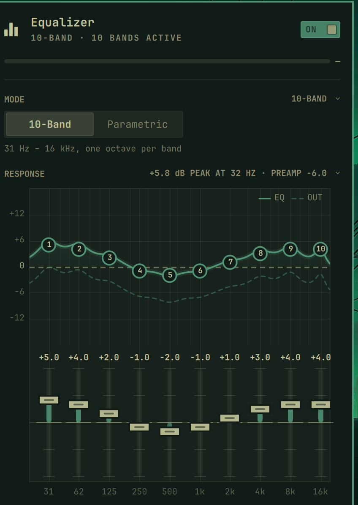
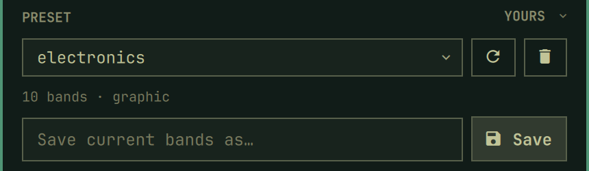

# Equalizer

An Omarchy shell plugin that puts a system-wide equalizer in front of any PipeWire
output: a 10-band graphic EQ, unlimited parametric bands, level-matched presets,
AutoEq headphone import, automatic headroom, and an output stage (brickwall
limiter plus a multiband "Magic Boost" compressor).



Everything is driven from the panel; the same operations are available from the
command line.

## Install

```sh
omarchy plugin add https://github.com/creolben/omarchy-equalizer.git --enable
```

That is the whole install. The plugin carries its own backend
(`bin/omarchy-equalizer`) and the panel addresses it inside the plugin directory,
so nothing has to be put on `PATH`. It appears in the bar as an equalizer icon;
click it, or run `omarchy-shell shell summon io.github.creolben.equalizer`.

To work on the plugin instead, clone it in place:

```sh
git clone https://github.com/creolben/omarchy-equalizer.git \
  ~/.config/omarchy/plugins/io.github.creolben.equalizer
omarchy plugin enable io.github.creolben.equalizer
./install.sh    # optional: puts the `omarchy-equalizer` CLI on your PATH
```

### Requirements

- Omarchy (quickshell) with a systemd user session
- PipeWire and `pactl` (pipewire-pulse), `jq`, `awk`, coreutils
- `curl` for AutoEq import; `node` to run the test suite
- Optional: `lsp-plugins-lv2` for the output stage. Without it the equalizer runs
  as a pure EQ and the limiter/boost controls report the stage as inactive.

Enabling makes the equalizer the default sink and moves application streams onto
it; disabling restores the output you had selected. While it is on, the volume
keys control its level, which is applied before the bands.

### Uninstall

Take the equalizer out of the audio path **first** — that restores the output
device you had selected and stops both units, so removing the plugin afterwards
cannot leave your machine pointing at a sink that no longer exists:

```sh
~/.config/omarchy/plugins/io.github.creolben.equalizer/bin/omarchy-equalizer disable
omarchy plugin disable io.github.creolben.equalizer
omarchy plugin remove io.github.creolben.equalizer --yes
```

Then delete what the plugin wrote outside its own directory:

```sh
rm -f  ~/.local/bin/omarchy-equalizer                       # only if you ran install.sh
rm -f  ~/.config/pipewire/omarchy-equalizer.conf
rm -rf ~/.config/pipewire/omarchy-equalizer.conf.d          # the generated graph
rm -f  ~/.config/systemd/user/omarchy-equalizer.service \
       ~/.config/systemd/user/omarchy-equalizer-follow.service
rm -rf ~/.local/state/omarchy-equalizer                     # state, user presets, AutoEq cache
systemctl --user daemon-reload
```

The state directory holds your bands, your saved presets and your settings; keep
it if you plan to install the plugin again.

## How it fits together

- `bin/omarchy-equalizer` — a bash script that owns the state, generates the
  filter-chain fragment, and drives the systemd unit. All the DSP configuration
  lives here.
- `host/omarchy-equalizer.conf` — the filter-chain host, copied to
  `~/.config/pipewire/omarchy-equalizer.conf` on enable. This plugin runs its own
  PipeWire client (`pipewire -c omarchy-equalizer.conf`) rather than using the
  stock `filter-chain.conf`, which would merge every unrelated user fragment, and
  rather than `pipewire.conf.d`, which would need a `pipewire.service` restart —
  that drops every PulseAudio client connection.
- The graph itself is regenerated at
  `~/.config/pipewire/omarchy-equalizer.conf.d/90-eq.conf` whenever the *shape*
  changes (band count, or a band's filter type). Gain, frequency and Q are values
  on filters that already exist, so those are written into the running graph with
  `pw-cli set-param` and never restart anything.
- State lives outside the plugin, in
  `${XDG_STATE_HOME:-~/.local/state}/omarchy-equalizer/`: `state.json`,
  `presets.json` for user presets, and a cached AutoEq index.
- Two user units: `omarchy-equalizer.service` (the filter-chain) and
  `omarchy-equalizer-follow.service`, which re-aims the equalizer when the output
  device changes — plugging in headphones otherwise leaves the equalizer playing
  into the old device while apps bypass it.
- The panel is QML (`Panel.qml`, `ResponseCurve.qml`, the slider and switch
  widgets). `Model.js` holds the biquad response maths; the response curve the
  panel draws and the automatic headroom the backend computes are the same
  formulas, in JS and `awk` respectively, and `tests/headroom-check.js` keeps
  them honest against each other.

## Command line

```
status                          JSON state for the shell plugin
enable | disable | toggle       Switch the equalizer on or off
retarget                        Re-aim the EQ at the current output device
follow                          Watch for output changes (run by systemd)
set-mode <graphic|parametric>   Choose which band set is processed
set-gain <index> <dB>           Set one band's gain (live, no restart)
set-band <index> <gain|freq|q|type> <value>
add-band                        Append a parametric band
remove-band <index>             Drop a parametric band
apply-preset <name>             Load a preset
save-preset <name>              Save the current bands as a preset
delete-preset <name>            Delete a user preset
reset                           Flatten the current mode's gains
presets                         List preset names
set-preamp <dB>                 Whole-chain preamp (clamped to the curve's ceiling)
set-headroom <auto|manual>      Auto-track the preamp to the band peaks
set-limiter <on|off>            Brickwall output limiter (live, no restart)
set-boost <off|low|medium|high> Magic Boost compressor (live, no restart)
autoeq-search [--json] <name>   Search AutoEq headphone profiles
import-autoeq <name|file> [index-path]
                                Import an AutoEq profile, saved as a preset
```

Enabling makes the equalizer the default sink and moves application streams onto
it; disabling restores the output you had selected. While it is on, the volume
keys control its level, which is applied before the bands.

## Gain staging

- **Automatic headroom** (`headroom: auto`) recomputes the preamp from the peak of
  the whole curve on every band, mode, preset or import change, so a boost cannot
  clip. Moving the preamp by hand switches it to `manual`.
- **The ceiling** — manual headroom is not a volume control: the preamp may cut
  below the curve's own peak but never go past it, so the most gain it can hold is
  the value `auto` would have picked. The backend clamps there (with a line on
  stderr saying so) on every command that touches the bands, and the panel's preamp
  slider tops out at the same number, marked on its scale. The point is that the
  limiter stays a safety net: gain stacked above the ceiling is removed from every
  sample, which sounds loud and flat rather than clipped, so nothing else would
  report it.
- **Preamp changes rewrite the fragment.** The preamp is a live control, so the
  fragment on disk would otherwise keep the value from the last rebuild and a later
  restart would come up on a different chain than the one that was tuned.
- **A selected DSP sink is chained in front of, not resolved past.** Resolving
  through it to the hardware (which is what `physical_output` and
  `omarchy-audio-output-sink` do) would silently drop that correction; on an Asahi
  laptop the J313 speaker tuning is the largest single part of how the speakers
  sound.
- **Limiter** — last node in the graph, true-peak, −1 dBFS ceiling. Switched by its
  `enabled` control, so it never restarts the chain.
- **Magic Boost** — `mb_compressor_mono` split into bass / mid / treble at 200 Hz
  and 4 kHz, Off / Low / Medium / High. Compresses and adds makeup gain. A
  single-band compressor would duck the whole spectrum on every bass hit.
- Both output nodes stay in the graph permanently; only their `enabled` control
  moves, because a graph-shape change is a unit restart and an audible dropout.

## Tests

```sh
bash tests/run-tests.sh     # 145 assertions, no real sink touched
node tests/curve-check.js   # Model.js response maths vs PipeWire's own biquads
```

The suite stubs `pactl`, `pw-cli`, `pw-dump`, `pw-metadata`, `systemctl` and
`curl` on a scratch PATH and points `XDG_CONFIG_HOME`/`XDG_STATE_HOME` at a
throwaway root, so fragments and state land in isolation and the machine keeps
playing. `systemctl` and `pw-cli` calls are logged, which is how "a frequency
edit does not restart the unit" is an assertion rather than an observation.

`node tests/preset-levels.js` also runs inside the suite: it measures every
built-in preset's applied curve with the plugin's own model (at each graph rate
the chain can run at) and enforces the level-matching rules described under
[Presets](#presets), plus that each file names and describes itself.

## Presets

Built-in presets are JSON in `presets/`, one file each, and every file names and
describes itself:

```json
{
  "name": "Rock",
  "description": "Scooped low mids with a 3-4 kHz presence lift",
  "order": 30,
  "mode": "graphic",
  "preamp": -0.5,
  "graphic": [ { "type": "peaking", "freq": 31, "q": 1.41, "gain": 0 }, … ]
}
```

`name` is what the panel lists and what `apply-preset` takes; it has to match the
filename, and the test suite checks that. `description` is the line the panel
shows under the preset dropdown. `order` sorts the list — Flat first, then tone,
genre, speech, situation — and the user's own presets follow the built-ins. A
file without a `name` is not listed at all, so a half-written preset cannot
appear as a nameless entry.



### Presets are level-matched

Every built-in is designed so that applying it changes the *tone*, not the
loudness. This is the point of the set, and it is not how EQ presets are usually
built:

- A preset's shape is applied under the automatic preamp, so its **peak** always
  lands at 0 dBFS. What is left to choose is the **level** the rest of the curve
  sits at, and a curve built from boosts therefore plays several dB below Flat —
  at the same volume setting, with nothing left to turn up once the volume is
  already at the end of its travel.
- So the character lives in the *shape* instead: bass-forward presets roll the
  top off rather than lifting the bottom, and speech presets cut the rumble
  rather than adding presence on top of a full-range curve. Every built-in now
  lands within about 2 dB of Flat (the old set ran 3.2–7.2 dB below it, and
  differed from *each other* by 4 dB, which made the list a loudness comparison
  instead of a tone one).
- Anything that genuinely needs to be louder is what **Magic Boost** is for.
- `tests/preset-levels.js` measures each preset's applied curve with the plugin's
  own model, at more than one graph rate, and fails if a preset drifts more than
  2.5 dB from Flat, if the set spreads more than the same, if a curve runs over
  0 dBFS, or if a file stops describing itself. Adding a preset means it has to
  land in the same place.

A preset's `preamp` is written from the backend's own `auto_preamp_db` for its
bands — never by hand — so the file and the code cannot disagree, and applying a
preset under *manual* headroom never trips the clamp. The suite asserts the
equality for every file.

The set, in list order:

| Order | Preset | Mode | What it does |
| --- | --- | --- | --- |
| 10 | Flat | graphic | The neutral reference. |
| 20 | Bass Boost | graphic | Bass plateaus, top rolled off ~5 dB. |
| 21 | Treble Boost | graphic | The mirror: bass trimmed ~5 dB, top open. |
| 22 | Loudness | graphic | Equal-loudness smiley, ~3 dB dip at 1 kHz. |
| 23 | Warm Speakers | parametric | Low shelf up, treble down — warm and forward. |
| 30 | Rock | graphic | Scooped low mids, presence lift at 3–4 kHz. |
| 31 | Pop | graphic | Gentle and vocal-forward with a smooth top. |
| 32 | Dance | graphic | Bass plateau, broad 300 Hz–2 kHz scoop. |
| 33 | Jazz | graphic | Warm and smooth, top octaves rolled off. |
| 34 | Classical | graphic | Near-flat, soft 500 Hz dip, a touch of air. |
| 35 | Vocal | graphic | Bass trimmed, presence lifted. |
| 40 | Podcast | graphic | Rumble cut below 125 Hz, speech band at unity. |
| 41 | Speech Clarity | parametric | 55 Hz high-pass, 3 kHz intelligibility lift. |
| 50 | Late Night | graphic | Quiet hours: bass and treble trimmed, presence kept. |
| 51 | Gaming | graphic | Low-mid boom cut, 3–4 kHz footsteps lift. |
| 52 | Small Speakers | parametric | 55 Hz high-pass, boxiness cut, 3 kHz lift. |

The two high-pass presets are the only ones that deliberately sit ~2 dB below
Flat: a pink-noise sweep still has energy under the corner, while the speech and
small-speaker material they are for does not.

Graphic presets are all ten ISO bands as peaking filters, which is what lets a
preset switch crossfade live instead of restarting the chain (see the ramp in
`bin/omarchy-equalizer`). Keep that shape when adding one.

User presets live in `presets.json` under the state directory; they have no
description and no order, so the panel shows their band count instead.
`import-autoeq` downloads a measured profile from
[AutoEq](https://github.com/jaakkopasanen/AutoEq) (MIT), applies it and saves it
as a preset. Profile names and the preset list are matched exactly, so check that
the model you import is the device you are listening on — an over-ear profile
applied to in-ear buds is a correction for the wrong acoustics.

## License

MIT — see [LICENSE](LICENSE).

The AutoEq headphone profiles this plugin can import come from
[jaakkopasanen/AutoEq](https://github.com/jaakkopasanen/AutoEq), also MIT.